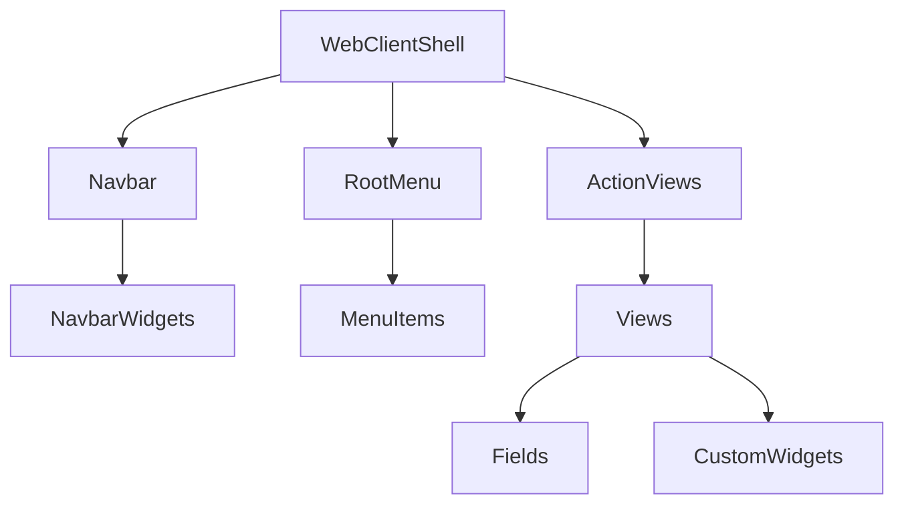

# План: библиотека Odoo-виджетов (FigCraft JSON)

## Цель

Декомпозировать типичный **Odoo 20 Web Client** на переиспользуемые виджеты. Каждый виджет — **один JSON-файл**: метаданные для композиции + вложенный FigCraft-фрагмент для макета. Из виджетов позже собираются демо-страницы для обсуждения с клиентами.

## Формат файла (гибрид C)

Единая схема для всех виджетов:

```json
{
  "schemaVersion": 1,
  "class": "Navbar",
  "odooVersion": "20",
  "category": "shell",
  "description": "Top application navbar",
  "size": { "width": 1366, "height": 46 },
  "slots": [
    { "name": "apps", "accepts": ["NavbarAppsMenu"] },
    { "name": "systray", "accepts": ["NavbarSystrayItem"] }
  ],
  "variants": ["default"],
  "figcraft": {
    "kind": "fragment",
    "root": { "type": "FRAME", "name": "Navbar", "...": "..." }
  }
}
```

Правила:
- **Имя файла** = `class` в snake_case: `Navbar` → [`widgets/shell/navbar.json`](widgets/shell/navbar.json)
- Один класс — один файл; варианты живут внутри `variants` / переключаемых слоёв во фрагменте, не отдельными файлами
- `figcraft.root` — самодостаточный фрагмент (FRAME + дети), открываемый/вставляемый в FigCraft
- `slots` описывают, куда при сборке страницы подставляются дочерние виджеты

## Дерево каталогов

```
widgets/
  shell/           # каркас приложения
  navbar_widgets/  # элементы systray / apps menu
  menu/            # root menu + menu items
  views/           # list, form, kanban, ...
  fields/          # char, many2one, boolean, ...
  custom/          # кастомные виджеты под проекты
docs/
  superpowers/
    specs/         # дизайн-спека формата
catalog.json       # индекс всех виджетов (class → path)
README.md
```

## Карта декомпозиции (первый срез)



| Категория | Классы (файлы) | Приоритет |
|-----------|----------------|-----------|
| shell | `web_client_shell`, `navbar` | P0 |
| navbar_widgets | `navbar_apps_menu`, `navbar_systray_item`, `navbar_user_menu`, `navbar_messaging_menu` | P0 |
| menu | `root_menu`, `menu_item` | P0 |
| views | `list_view`, `form_view`, `kanban_view`, `control_panel` | P1 |
| fields | `char_field`, `text_field`, `boolean_field`, `many2one_field`, `selection_field`, `date_field`, `monetary_field` | P1 |
| custom | (пусто, шаблон `_template.json`) | P2 |

Визуальный эталон: **условный типичный Odoo 20 Web Client** (знакомый chrome: тёмный/фирменный navbar, боковое/приложения-меню, control panel, list/form) — не пиксель-перфект конкретной БД.

## Порядок работ

1. **Спека формата** — зафиксировать схему гибридного JSON + соглашения об именах/слотах в [`docs/superpowers/specs/`](docs/superpowers/specs/)
2. **Скелет репо** — папки, `catalog.json`, `README`, шаблон виджета
3. **P0 shell** — `web_client_shell`, `navbar`, navbar widgets, `root_menu`, `menu_item` как FigCraft-фрагменты + метаданные
4. **P1 views/fields** — control panel + list/form/kanban и базовые поля
5. **Сборка-демо** — один составной макет страницы (например list view внутри shell) для проверки слотов
6. **P2 custom** — соглашение и шаблон для клиентских виджетов

## Критерии готовности первой волны (P0)

- Каждый P0-файл валиден по схеме и открывается/вставляется в FigCraft
- Имена файлов = snake_case от `class`
- `catalog.json` перечисляет все виджеты
- Есть один демо-экран «shell + navbar + menu + пустая область view»

## Вне скоупа сейчас

- Генератор страниц / CLI-сборка из слотов
- Полный каталог всех OWL-виджетов Odoo
- Пиксель-перфект с живого инстанса
- Прототипирование кликов (можно добавить позже)
