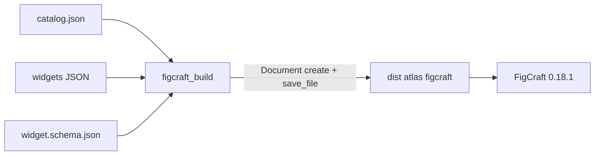

# План: утилита сборки `.figcraft` из JSON-виджетов

## Тезисы (заказчик)

- Сначала сборка всех виджетов отдельным файлом (атлас), чтобы сверять элементы, потом — экранные формы.
- Нужна утилита, которая алгоритмически собирает артефакт для FigCraft: работаем только с JSON, валидация и результат детерминированы.
- Язык утилиты — Rust.
- Исходники утилиты — в отдельном каталоге.

## План (агент)

### Overview

Пользователь правит JSON-виджеты в `widgets/`. Команда в каталоге утилиты (`figcraft_build`) проверяет их и собирает файл атласа `.figcraft` в `dist/`. Этот файл открывается в FigCraft: все виджеты на одном холсте по категориям. Экранные формы в этой версии не собираем.

### Зафиксированные решения

- Язык: **Rust**; исходники — каталог верхнего уровня [`figcraft_build/`](figcraft_build/), рядом с `widgets/` и `demos/`
- Источник правды: JSON (`widgets/`, `catalog.json`). `.figcraft` — только выход сборки
- Запись файла: крейты `figcraft-doc` + `figcraft-format` из репозитория [storytold/figcraft](https://github.com/storytold/figcraft), **git pin на commit приложения** `4acc293c2ec941ac1400837ee7e3ab51780399f8` (FigCraft **0.18.1** из Info.plist). Не crates.io 0.5.1 — версии расходятся с установленным приложением
- Toolchain: [`rust-toolchain.toml`](rust-toolchain.toml) в корне с **`channel = "1.95"`** — это `rust-version` workspace FigCraft на pin `4acc293…`. `Cargo.lock` коммитим. Локально допустим более новый rustc ≥ 1.95 (сейчас часто 1.98.x)
- Зависимости CLI помимо FigCraft: `clap` (derive), `serde` / `serde_json`, `jsonschema`, `anyhow` (или `thiserror` + `anyhow` на границе CLI)
- API: `Document::new` → `Document::create` → `node_mut` → `figcraft_format::save_file` / `save_bytes`
- **Без** `figcraft-engine` / `normalize` в v1: размеры и координаты берём из JSON как записано. Автолейаут в атласе может визуально отличаться от «живого» FigCraft после ручного редактирования — приемлемо для сверки фрагментов; normalize — этап 2 при необходимости
- Первая компиляция тяжёлая (цепочка `figcraft-format` → image / craft-* / zip) — ожидаемо; в CI нужен доступ в сеть к GitHub (`storytold/figcraft` и транзитивные git-deps)
- Артефакты: `dist/` в `.gitignore`; также игнорировать `target/`
- Команды v1: `validate`, `atlas`
- Валидация: крейт `jsonschema` по [`schemas/widget.schema.json`](schemas/widget.schema.json) **плюс** свои проверки (имя файла = snake_case от `class`, слоты ↔ `slot:*`, path из catalog существует, `_template.json` не в catalog). Схема допускает типы слоёв шире, чем convert v1 — лишние типы ловит convert, не schema
- Конвертер v1 поддерживает **только типы и props, которые реально есть в текущем catalog** (см. ниже). Любой другой `type` / ключ `props` — ошибка с путём к виджету
- Атлас — вёрстка зафиксирована ниже (не угадывать при реализации)
- Удалить MCP-демо: [`demos/demo_contacts_list_kanban_form.figcraft`](demos/demo_contacts_list_kanban_form.figcraft) и [`demos/demo_contacts_list_kanban_form.json`](demos/demo_contacts_list_kanban_form.json)
- [`demos/demo_shell_empty_action.json`](demos/demo_shell_empty_action.json) **оставить**, в README пометить: справочный compose, пока не собирается билдером
- CI: сразу добавить GitHub Actions с `cargo test -p figcraft_build` (ubuntu-latest, установка toolchain из `rust-toolchain.toml`)
- Thumbnail в `.figcraft` не пишем

### Поток данных



### Структура репозитория

```
figcraft_odoo_widgets/
  widgets/
  catalog.json
  schemas/
  demos/
  dist/                      # gitignore
  target/                    # gitignore
  rust-toolchain.toml
  Cargo.toml                 # workspace: members = ["figcraft_build"]
  Cargo.lock
  .gitignore
  .github/workflows/ci.yml
  figcraft_build/            # исходники утилиты
    Cargo.toml
    README.md
    src/
      main.rs
      catalog.rs
      widget.rs
      validate.rs
      convert.rs
      atlas.rs
      props.rs
      root.rs                # поиск корня репо (--root / CARGO_MANIFEST_DIR)
    tests/
      fixtures/
      convert_tests.rs
      atlas_tests.rs
      roundtrip_tests.rs
      catalog_tests.rs       # обязательный прогон по реальному catalog
```

Запуск: `cargo run -p figcraft_build -- atlas`. Корень данных по умолчанию — родитель `figcraft_build/` (корень репо); флаги `--root`, `--catalog`, `--out`.

### Вёрстка атласа (фиксировано)

Порядок **секций категорий** — как таблица в спеке формата виджетов (не порядок first-seen в `catalog.json`):

1. `shell`
2. `navbar_widgets`
3. `menu`
4. `views`
5. `fields`
6. `custom_views`
7. `discussion`
8. `custom`

Пустую категорию (нет записей в catalog) **не рисуем**. Внутри секции виджеты — в порядке появления в `catalog.json` среди этой категории.

Структура слоёв:

| слой | смысл |
|------|--------|
| корневой frame `Atlas` | вертикальный автолейаут, `gap` **80**, `padding` **40**, `fill` `#F9F9F9` (`canvas`), `sizingH`/`sizingV` hug |
| секция `category:<name>` | вертикальный frame, `gap` **24**, hug |
| заголовок | `text`, имя категории как в JSON (`shell`, …), `fontSize` **20**, `fill` `#212529` |
| ряды `row:N` | горизонтальный frame, `gap` **40**, hug; при добавлении следующего виджета, если ширина ряда стала бы **> 2400**, открыть новый ряд |
| виджет | корень `figcraft.root` виджета (имя слоя = `class`), размеры из JSON |

Межрядный зазор внутри секции — тот же вертикальный `gap` **24** у секции (ряды — её дети).

### Маппинг fragment → FigCraft (v1, по факту catalog)

Типы в текущих 28 виджетах: `frame`, `text`, `ellipse`, `rectangle`.

| fragment `type` | `NodeKind` |
|-----------------|------------|
| frame | Frame |
| rectangle | Rectangle |
| ellipse | Ellipse (defaults) |
| text | Text(TextData) |

Любой другой `type` → ошибка.

Разрешённые `props` (все встречаются в catalog): `fill`, `stroke`, `strokeWeight`, `strokeAlign`, `cornerRadius`, `layout`, `gap`, `padding`, `mainAlign`, `crossAlign`, `wrap`, `sizingH`, `sizingV`, `fontFamily`, `fontStyle`, `fontSize`, `textAlign`. Иной ключ → ошибка.

Детерминизм: DFS при обходе fragment, id через `alloc_id`, порядок секций — список выше, внутри секции — порядок catalog. Сравнение повторных сборок — по дереву имён/типов/размеров после `load_bytes`, не по байтам ZIP.

### Тесты

1. **props**: `#714B67`, `#RRGGBBAA`, padding число / `[t,r,b,l]`, sizing; неизвестный ключ props → Err
2. **validate**: валидный виджет ок; битая schema → Err; slot без `slot:name` → Err; path из catalog не существует → Err
3. **convert**: fixture frame+text+rectangle → Document с верными символами текста
4. **atlas layout**: 2–3 фиктивных виджета разных category → имена секций и порядок **по списку спеки** (не по порядку в тестовом catalog); пустая category не создаёт секцию; перенос ряда при ширине > 2400
5. **roundtrip**: `save_bytes` → `load_bytes`; `Document::validate()` пустой; repairs не критичны
6. **catalog integration** (обычный тест, не `#[ignore]`): `validate` + сборка atlas по реальному дереву репо во временный файл — число top-level виджетов = числу записей catalog, все `class` на месте

`cargo test -p figcraft_build`

### Документация

- [`README.md`](README.md): сборка атласа, правка JSON, открытие `dist/`; убрать акцент на MCP Contacts; пометка про `demo_shell_empty_action`
- Спека: `docs/superpowers/specs/2026-11-26-figcraft-build-tool-design.md`
- [`figcraft_build/README.md`](figcraft_build/README.md): CLI, pin FigCraft, toolchain

### Шаги работ

1. Создать workspace, `figcraft_build/`, `rust-toolchain.toml` с `channel = "1.95"`, `.gitignore` (`target/`, `dist/`), зависимости: FigCraft git pin `4acc293…` + clap / serde / jsonschema / anyhow
2. Реализовать поиск корня репо, чтение catalog и виджетов
3. Реализовать `validate` (jsonschema + инварианты)
4. Реализовать `props` и `convert` только для типов/ключей из текущего catalog
5. Реализовать `atlas` по таблице вёрстки выше и запись `dist/atlas_all_widgets.figcraft`
6. Написать тесты (включая обязательный catalog integration)
7. Добавить `.github/workflows/ci.yml` с `cargo test`
8. Обновить README и спеку; удалить Contacts MCP-демо; пометить demo_shell
9. Вручную: `validate`, `atlas`, открыть файл в FigCraft 0.18.1

### Проверка вручную

1. `cargo test -p figcraft_build`
2. `cargo run -p figcraft_build -- validate`
3. `cargo run -p figcraft_build -- atlas`
4. Открыть `dist/atlas_all_widgets.figcraft` в FigCraft 0.18.1 — секции по категориям, виджеты читаемы, без ошибки загрузки

### Вне первой версии

- Сборка экранных форм и монтаж в фреймы-слоты (`slot:*`)
- `figcraft-engine::normalize` для автолейаута
- Типы слоёв вне текущего catalog (vector, component, …)
- thumbnail.png
- Публикация CLI на crates.io
