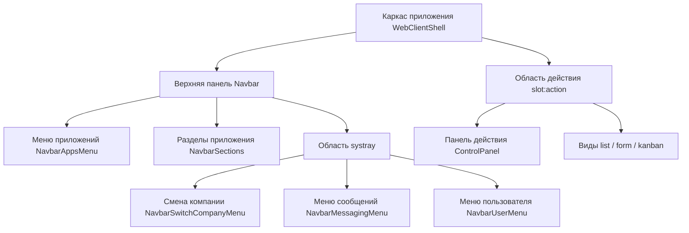

# План: виджеты под Odoo 20 Community

## Тезисы (заказчик)

- Скорректировать текущие виджеты по исходникам Odoo 20 в `core-20/odoo/addons`, модуль `web` (и связанный `mail` для Discuss/Activity).
- Целевая редакция: **Community**.

## План (агент)

### Overview

Макеты в `widgets/` начнут совпадать с типичным экраном Odoo 20 **Community**: фиолетовый бренд `#71639E`, каркас «верхняя панель приложения + область действия» без постоянного левого меню, верхняя панель и панель действия как в исходниках. После правок — описания и прогон сборки / `verify-all` + открытие в FigCraft.

### Зафиксированные решения

- Редакция: **Community**. Бренд верхней панели / primary / `$o-action` в Community: `#71639E` (`$o-community-color` / `$o-brand-odoo`). Не `#714B67` (enterprise).
- Все hex в JSON и спеке — **верхний регистр** (`#71639E`, не смешанный регистр).
- Фон приложения (`canvas`): `#F8F9FA` (`$o-gray-100`).
- Hover / active бренда (`brandDark`): `#5C5282` — **библиотечный** токен (~10% затемнение бренда для hover в макетах; в SCSS Odoo отдельного имени нет). Старый `#5D3E56` убрать из спеки.
- Основные кнопки / primary action (`primaryBtn` / action): **тот же бренд** `#71639E` (в Community `$o-action` = `$o-brand-primary`). Не бирюза.
- Акцент ссылок Discuss / messaging (`link`): `#017E84` (`$o-enterprise-action-color`; в `mail` используется и в Community). Старый `#008784` заменить на него. **Не** красить primary-кнопки этим цветом.
- Badge в верхней панели: `#28A745` (`$o-navbar-badge-bg` / `$o-success`).
- Каркас ([`web_client_shell.json`](widgets/shell/web_client_shell.json)): только верхняя панель (`Navbar`) + область действия (`slot:action`). Слот постоянного левого меню убрать.
- Боковая панель списка приложений: виджеты [`root_menu.json`](widgets/menu/root_menu.json) и [`menu_item.json`](widgets/menu/menu_item.json) — **`class` остаётся `RootMenu` / `MenuItem`**; переосмыслить как содержимое боковой панели AppsMenu (`web.NavBar.AppsMenu.Sidebar`); **оставить категорию `menu`** в catalog; обновить `description` и `tags` (`apps-sidebar`); из слотов shell и демо не монтировать.
- Верхняя панель ([`navbar.json`](widgets/shell/navbar.json)): AppsMenu → название текущего приложения → разделы текущего приложения → systray. Высота **46px**. Слоты: `apps`, `sections`, `systray`. Обновить `accepts` и `slotAnchors` под новые классы.
- Новый виджет разделов: **`class` `NavbarSections`**, файл [`widgets/navbar_widgets/navbar_sections.json`](widgets/navbar_widgets/navbar_sections.json) (смысл — `web.NavBar.SectionsMenu`); слот `sections` в Navbar.
- Systray первой версии: меню пользователя (`NavbarUserMenu`), сообщения (`NavbarMessagingMenu`), смена компании — **новый** **`class` `NavbarSwitchCompanyMenu`**, файл [`widgets/navbar_widgets/navbar_switch_company_menu.json`](widgets/navbar_widgets/navbar_switch_company_menu.json) (в Odoo — `SwitchCompanyMenu`; префикс `Navbar` как у остальных пунктов systray). Общий [`navbar_systray_item.json`](widgets/navbar_widgets/navbar_systray_item.json) **оставить** как шаблон. В `accepts` слота `systray` добавить `NavbarSwitchCompanyMenu`. Badge — `#28A745`.
- Пункты systray «бургер» и «офлайн» — **вне этой версии** (см. ниже).
- Панель действия ([`control_panel.json`](widgets/views/control_panel.json)): три зоны — кнопки + хлебные крошки | действия (поле поиска) | навигация (pager + переключатель видов). У list / form / kanban обновить `accepts` / якоря, чтобы стыковались с новой панелью. Боковую **SearchPanel** у list/kanban в этой версии **не добавлять**.
- Поле даты/времени: один макет **`DateTimeField`** (`date_time_field.json`) на оба типа поля Odoo (`date` и `datetime` — один компонент). Удалить `date_field.json` / `DateField`; обновить catalog и все `accepts` (в т.ч. form).
- Шрифт в `props.fontFamily` всех текстовых узлов: **`Inter`** как стабильная замена system UI Odoo в FigCraft; в спеке явно: «в живом Odoo — system stack; в макетах FigCraft — Inter».
- Discuss / Activity сверять с модулем `mail` в `core-20/odoo/addons/mail/static/src` (акценты ссылок — `#017E84`).
- Демо [`demos/demo_shell_empty_action.json`](demos/demo_shell_empty_action.json): пересобрать под каркас без левого меню (navbar + пустая область действия); цвета Community.
- [`figcraft_build/README.md`](figcraft_build/README.md) в этой доработке **не менять** (CLI без изменений).
- Источник правды — JSON; после правок: `validate`, `verify-all`, тесты.

### Карта слоёв (Community)

### Таблица токенов (после правки)

| Смысл | Значение | Было |
|-------|----------|------|
| brand / navbar / primaryBtn | `#71639E` | `#714B67` |
| brandDark (библиотечный hover) | `#5C5282` | `#5D3E56` |
| canvas | `#F8F9FA` | `#F9F9F9` |
| surface | `#FFFFFF` | без изменений |
| border | `#DEE2E6` | без изменений |
| text | `#212529` | без изменений |
| muted | `#6C757D` | без изменений |
| link / Discuss | `#017E84` | `#008784` |
| navbar badge | `#28A745` | `#EB7F6D` |

### Шаги работ

1. Обновить визуальный язык в [`docs/superpowers/specs/2026-11-26-odoo-widget-format-design.md`](docs/superpowers/specs/2026-11-26-odoo-widget-format-design.md) и [`README.md`](README.md): Community; токены из таблицы (**primary ≠ link**); каркас без левого меню; шрифт Inter в FigCraft; `brandDark` как библиотечный hover.
2. Массово заменить цвета во всех JSON в `widgets/` и в [`demos/demo_shell_empty_action.json`](demos/demo_shell_empty_action.json): `#714B67`→`#71639E`, `#F9F9F9`→`#F8F9FA`, `#008784`→`#017E84`, `#EB7F6D`→`#28A745`, `#5D3E56`→`#5C5282` где встречается.
3. Пересобрать каркас приложения: слоты `navbar` + `action`; убрать `menu` / `slot:menu`.
4. Пересобрать верхнюю панель: слоты `apps`, `sections`, `systray`; название текущего приложения; `accepts` / `slotAnchors` под `NavbarAppsMenu`, `NavbarSections`, systray-классы.
5. Добавить [`navbar_sections.json`](widgets/navbar_widgets/navbar_sections.json) (`NavbarSections`); добавить [`navbar_switch_company_menu.json`](widgets/navbar_widgets/navbar_switch_company_menu.json) (`NavbarSwitchCompanyMenu`); доработать Apps / User / Messaging и badge; уточнить description у шаблонного systray-пункта.
6. Обновить description/tags у `RootMenu` и `MenuItem` (класс не переименовывать); убрать из демо shell.
7. Пересобрать панель действия под три зоны; обновить `accepts` / якоря у list / form / kanban под неё.
8. `DateField` → `DateTimeField` (один виджет на date и datetime): файл + catalog + accepts.
9. Discuss / Activity: цвета (ссылки `#017E84`, бренд где нужно) и базовая компоновка по `mail`.
10. Обновить [`catalog.json`](catalog.json) (новые классы `NavbarSections`, `NavbarSwitchCompanyMenu`, `DateTimeField` и path).
11. Обновить `description` затронутых виджетов по-русски.
12. Проверка: `validate`, `verify-all`, `cargo test -p figcraft_build`; в FigCraft — каркас, верхняя панель, панель действия, один вид; обновить [`dist/widget_qa_checklist.md`](dist/widget_qa_checklist.md).

### Документация

- Спека формата: токены Community (brand / primaryBtn отдельно от link; brandDark как библиотечный); каркас NavBar+Action; роль RootMenu как sidebar AppsMenu; шрифт; имена новых классов.
- README: ориентир Community; демо shell без левого меню.
- `description` у изменённых виджетов.
- catalog.json — полный индекс.

### Проверка

- Файлы соответствуют [`schemas/widget.schema.json`](schemas/widget.schema.json); имена = snake_case от `class` (`date_time_field.json`, `navbar_sections.json`, `navbar_switch_company_menu.json`).
- `verify-all`: fragment ↔ `.figcraft` без diffs.
- FigCraft: каркас / верхняя панель / панель действия читаемы; бренд `#71639E`; primary-кнопки не бирюзовые; ссылки Discuss `#017E84`; в shell нет постоянного левого меню; демо без левого меню.
- Чеклист QA в `dist/` обновлён.

### Вне первой версии

- Пункты systray: бургер-меню и индикатор офлайна.
- Боковая SearchPanel у list/kanban.
- Отдельные виджеты только для `date` vs только для `datetime`.
- Полный пиксель-перфект hover/dropdown.
- Отдельная ветка токенов Enterprise.
- Нормализация автолейаута через `figcraft-engine`.
- Сборка полных экранных форм в слоты.
