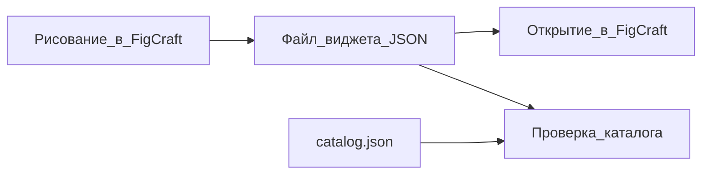

## Тезисы (заказчик)

Каталог JSON-документов: каждый файл — макет виджета Odoo, открывается в FigCraft. Обёртка для сборки сложных макетов не должна ломать нативный механизм. Гибридный `figcraft.root` убираем из хранилища.

Если есть оригинальный JSON-документ FigCraft — не конвертировать его в бинарный `.figcraft` ради каталога. Конвертер формата для одиночного виджета ничего не даёт, кроме ошибок.

Все работы ведутся в текстовых форматах файлов, без бинарных — в том числе когда сборщик собирает сложные макеты из деталей по метаописанию: и детали, и результат сборки — JSON (текст), не zip/`.figcraft`.

## План (агент)

### Что получит пользователь

Библиотека виджетов Odoo: каждый файл в `widgets/` открывается в FigCraft как обычный макет. Список виджетов и правила «куда что вставлять» — в `catalog.json`. Сборка сложных экранов позже тоже пишет текстовый JSON. Бинарные `.figcraft` в пайплайне не используются.

### Зафиксированные решения

- **Только текст:** виджеты, каталог, демо, выход любого будущего сборщика — текстовый JSON. Бинарные `.figcraft` / zip не храним и не выдаём как результат работы.
- **Хранилище макета:** `widgets/.../<имя>.json` — нативный документ FigCraft (`format`, `version`, `nodes`, `pages`, …). Открывается в FigCraft без утилиты.
- **Обёртка:** только [`catalog.json`](catalog.json). В записи виджета: `class`, `category`, `path`, `description`, `size`, `slots` / `accepts`, `variants`, `tags`. Внутри файла макета этих полей нет.
- **Версия Odoo:** только на корне каталога (`odooVersion`). Из файлов виджетов поле не дублируем.
- **Якоря слотов (`slotAnchors`):** в каталог не переносим. Точка вставки — фрейм с именем `slot:<имя>` в макете; контракт имён — в `slots` записи каталога. При миграции словари `slotAnchors` из гибридов отбрасываем.
- **Размер:** видимый размер — ширина/высота корня макета в JSON. Поле `size` в каталоге — для проверки и будущей сборки; при расхождении с корнем документа проверка каталога (`validate`) — ошибка.
- **Слоты:** в макете — фреймы `slot:<имя>`; в каталоге — контракт; `validate` сверяет.
- **Утилита в первой версии:** команда проверки каталога (`validate`). Команды `widget`, `atlas`, `verify-all` и любой код записи `.figcraft` как нормального выхода — **удалить** (не оставлять «выключенными»).
- **Конвертер гибрида до конца миграции:** модули `convert` / `FragmentNode` и чтение гибридного JSON **оставляем** до шага «удалить гибридный DSL». Они нужны, чтобы один раз получить нативный JSON через `to_json`. Удаляем их только после пакетной миграции и строгого `validate`.
- **Миграция с гибрида:** только текстовый выход через `figcraft_format::to_json` (гибрид → Document в памяти → JSON на диск). Zip/`.figcraft` на диске не создавать.
- **Пилот:** поле даты-времени (`DateTimeField`). Стартовый нативный JSON → открыть в FigCraft → довести вид к Odoo → сохранить JSON → метаданные в каталоге. Не считать пилотом слепой дамп без сверки с Odoo.
- **Порядок и смешанный каталог:** строгий `validate` «все файлы — нативные документы» включаем **после** пакетной миграции. До этого — пилот и точечные тесты на один виджет; весь каталог целиком строгим native-`validate` не гоняем.
- **План round-trip / хэш `.figcraft`:** отменён; не выполнять.
- **Демо** [`demos/demo_shell_empty_action.json`](demos/demo_shell_empty_action.json): в первой версии не мигрируем. Файл оставляем; в корневом README явно помечаем: устаревший справочный compose, вне нового формата, не проверяется `validate`. Перевод демо — отдельная работа.
- **Старая спека гибрида** [`docs/superpowers/specs/2026-11-26-odoo-widget-format-design.md`](docs/superpowers/specs/2026-11-26-odoo-widget-format-design.md): в начале файла — статус «устарела» и ссылка на новую спеку. Новая спека — `docs/superpowers/specs/2026-11-26-native-widget-storage-design.md`.
- **Гибридный DSL** и [`schemas/widget.schema.json`](schemas/widget.schema.json): жить только до конца пакетной миграции; затем удалить. Схема каталога — `schemas/catalog.schema.json`, `schemaVersion` каталога → `2`.

### Шаги работ

1. **Спека** — написать `docs/superpowers/specs/2026-11-26-native-widget-storage-design.md`. В старой гибридной спеке сверху: «устарела» + ссылка на новую.
2. **Убрать бинарный путь** — удалить команды CLI и код, которые **пишут** `.figcraft` (`widget`, `atlas`, `verify-all` и тесты на этот выход). `convert` / `FragmentNode` / чтение гибрида **не трогать** (нужны для шагов 3–4). Удалить локальные `dist/*.figcraft`. Обновить [`figcraft_build/README.md`](figcraft_build/README.md): утилита пока без atlas/widget.
3. **Пилот DateTimeField** (нужны FigCraft и живой Odoo)
   - гибрид → Document в памяти → нативный JSON на диск (`to_json`), без zip;
   - метаданные этой записи в `catalog.json`;
   - открыть JSON в FigCraft; сверка со скрином Odoo; поправить макет; Save в [`widgets/fields/date_time_field.json`](widgets/fields/date_time_field.json);
   - точечные тесты load + проверка этой записи (весь каталог строгим native-`validate` ещё не гоняем).
4. **Пакетная миграция** остальных гибридов тем же текстовым путём; заполнить у всех записей каталога поля v2 (`description`, `size`, `slots`, `variants`, `tags`).
5. **Строгий validate + catalog v2** — `schemas/catalog.schema.json`, `schemaVersion: 2`; проверка: нативный документ, имя файла = snake_case от `class`, слоты, правило `size`, корень макета. Прогон на всём каталоге.
6. **Удалить гибридный DSL** — только после зелёного шага 5: `FragmentNode`, `convert`, гибридная `widget.schema.json`, сравнение фрагмент↔документ, мёртвые тесты.
7. **Документация и демо** — корневой [`README.md`](README.md): открытие JSON в FigCraft; утилита = `validate`; только текст; демо помечено вне формата.

### Документация

- Новая спека native storage; старая гибридная — «устарела» + ссылка.
- Корневой README — шаг 7; README `figcraft_build` — после шага 2 без atlas/widget, после шага 6 только `validate` (временную migrate убрать вместе с DSL).
- Описания виджетов живут в записях `catalog.json` (поле `description`).

### Проверка

- К шагу 3 доступны FigCraft и живой Odoo (Community) для сверки пилота.
- `date_time_field.json` открывается в FigCraft без сборки.
- Визуально поле даты-времени ≈ Odoo Community (скрин FigCraft + браузер).
- Имя файла каждого виджета = snake_case от `class` в каталоге.
- `cargo test -p figcraft_build` и `validate` по всему каталогу проходят **после** шага 5.
- В `widgets/` нет `figcraft.root` и гибридного `schemaVersion` у виджетов.
- В коде/README нет пути «собери `.figcraft`»; команды утилиты не пишут `.figcraft` как нормальный выход.
- В README демо помечено вне нового формата.
- После шага 6 в основном пути нет `convert` / `FragmentNode`.

### Вне первой версии

- Сборщик сложных макетов / атлас из деталей по метаописанию: выход только текстовый JSON FigCraft.
- Перенос демо в нативный формат.
- Save из FigCraft в path виджета как обычный цикл правки.

### Сознательно вне цели

- Бинарные `.figcraft` / zip как хранилище или выход сборки.
- Round-trip и хэш бинарных файлов через свой DSL.
- Гибридный `figcraft.root` как source of truth.
- Миграция демо в первой версии.
- Перенос `slotAnchors` в каталог.
- «Улучшить все виджеты до пиксель-перфекта» — только пилот datetime + формат; остальные после миграции можно доводить позже.
